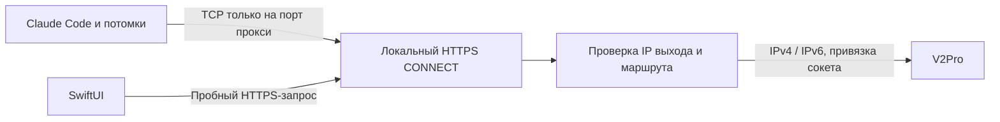

# Архитектура TunnelGuard

Первый этап — macOS на Apple Silicon. Пользователь выбирает полнотуннельный VPN-профиль и ожидаемые IP выхода. Системный фильтр по приложениям остаётся целью. В текущем запускаторе граница изоляции проходит по процессу и его обычным потомкам.

- `Scripts/tunnelguard-run.py` запускает программу в песочнице macOS. Прокси живёт в отдельном от неё процессе. Он проверяет маршрут сокета и привязывает сокет к интерфейсу через `IP_BOUND_IF` или `IPV6_BOUND_IF`.
- `EgressPolicy` принимает решения на основе ожидаемых IP, независимых наблюдений для IPv4 и IPv6 и срока их действия. Системные вызовы и сетевые проверки находятся в адаптере macOS. Эти границы подходят для будущего выделения общей логики и платформенных адаптеров.
- `Sources/TunnelGuardApp` отображает результат диагностики. Запущенной из командной строки сессии прокси окно не требуется.
- `Sources/FilterProbe` содержит экспериментальный `NEFilterDataProvider`. На этом Mac он собран, но не загружен.

## Изолированный Claude Desktop

`Scripts/tunnelguard-desktop.py` запускает выделенную Debian VM и использует тот же прокси и `EgressPolicy` на Mac. SSH по `virtio-vsock` связывает гостевой `127.0.0.1:3128` с локальным HTTPS-прокси. Гость запускает официальный Claude Desktop и браузер от непривилегированного пользователя. Electron применяет собственную песочницу. [SSH через vsock в Lima](https://lima-vm.io/docs/config/port/), [Claude Desktop для Linux](https://support.claude.com/en/articles/10065433-install-claude-desktop).

У Lima 2.3 обнаружение vsock на холодном старте начинается с проверки SSH на частной IP-сети гостя. При загрузке `nftables` пропускает только loopback, DHCP к виртуальному шлюзу и ответы SSH в этой сети. Интернет-трафик гостя остаётся закрыт. Перед запуском Claude управление проверяет `vsock` и выключает все сетевые интерфейсы гостя, кроме loopback. Для просмотра окна VNC идёт в обратном направлении по тому же SSH-сеансу, с прослушиванием только локальных адресов. [Реализация Lima 2.3](https://github.com/lima-vm/lima/blob/v2.3.0/pkg/driver/vz/vm_darwin.go).

## Варианты системной изоляции

| Механизм | Результат |
| --- | --- |
| Свой Network Extension | Подходит для проверки потоков по идентичности приложения. Выбранный Apple путь активации с включённым SIP требует Developer ID и профилей. Платная подпись исключена условиями проекта. [Документация Apple](https://developer.apple.com/documentation/technotes/tn3134-network-extension-provider-deployment) |
| `sandbox-exec` и локальный прокси | Доступны локально без специальной подписи. Проверены для контролируемой команды и потомков. В тесте Electron Helper не смог инициализировать свою песочницу. [Песочница Chromium](https://chromium.googlesource.com/chromium/src/+/main/sandbox/mac/README.md) |
| macOS Packet Filter | Поддерживает правила TCP/UDP по владельцу сокета, что позволяет испытать отдельного пользователя. Атрибуция DNS через системный резолвер и совместимость с активными системными правилами требуют решения. [Документация Apple о PF](https://developer.apple.com/documentation/technotes/tn3165-packet-filter-is-not-api) |
| LuLu | Готовый бесплатный подписанный фильтр. В реализации есть ветки, разрешающие поток при сбое идентификации процесса. Для заявленного fail closed такая зависимость недостаточна. [Исходник фильтра LuLu](https://github.com/objective-see/LuLu/blob/master/LuLu/Extension/FilterDataProvider.m) |
| Выделенная Linux VM | Поддерживает официальный Claude Desktop ARM64, включая Electron. Сетевая политика действует на весь гость, а обычные приложения macOS работают отдельно. Используется как бесплатный режим Desktop. |

Windows остаётся после проверки macOS. Решения политики и тесты следует сохранить общими. Контроль маршрутов и фильтрация Windows потребуют собственного адаптера WFP.
